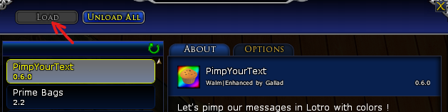
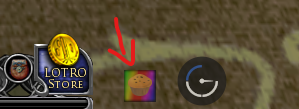
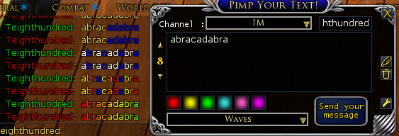
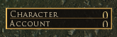
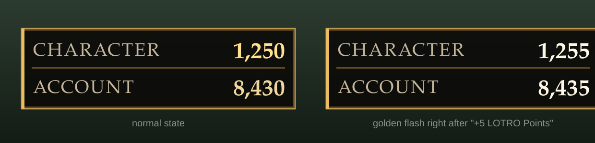

# This project is intended to develop new plugins for the game The Lord of the Rings Online and improve existing ones

## Pimp Your Text

A simple plugin that lets you colorize text.

Load the plugin

Select the rainbow-colored icon, and click it

A window will open with a text field, a channel selection field, and color options. Type the text, choose the Channel, apply the colors and hit the button "Send your message"

## Lotro Point Tracker

A plugin that tracks the LOTRO Points you earn and displays them in a small window at the top of the screen.

Load the plugin, and the tracker appears at the top center of the screen:

- **Character** — the LOTRO Points earned by the current character
- **Account** — the LOTRO Points earned account-wide

Example:

The window is locked by default, so it stays out of your way. It is styled after the native game UI: a translucent dark panel with a gold frame, Trajan font, and right-aligned gold totals with thousand separators (1,250). When you earn LOTRO Points, both totals briefly flash in bright gold.

The plugin works by watching the chat message "You've earned N LOTRO Points." and adding N to both counters. Totals are saved on unload: the character counter per character, the account counter for the whole account.

### Settings

Open the plugin manager to configure LotroPointTracker:

- **Move the window** — check the box to temporarily unlock the window so you can drag it to a new position
- **Window size** — set a custom width and height, then press Accept (the layout and font scale adapt automatically)

Position and size are saved, so the tracker reappears exactly where you left it.

### Commands

- `lpt reset_char` — reset the LOTRO Points counter for the current character
- `lpt reset_account` — reset the LOTRO Points counter for the account
- `lpt reset_all` — reset both counters

### Notes

- The tracker reacts only to the standard "You've earned N LOTRO Points." advancement message
- F12 (toggle HUD) hides the tracker along with the rest of the UI